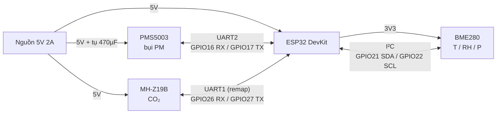

# Sơ đồ đấu nối một nút đo (bản nháp)

ESP32 DevKit (WROOM-32) + PMS5003 + MH-Z19B + BME280.

> **Đây là bản thiết kế sơ bộ.** Trước khi cấp điện, đối chiếu từng chân với datasheet và nhãn chân trên module thực tế của bạn. Mỗi hãng bo mạch có thể bố trí chân khác nhau.

## 1. Sơ đồ khối nguồn và tín hiệu



## 2. Bảng đấu nối

### Nguồn

| Từ | Đến | Ghi chú |
|---|---|---|
| Nguồn 5V (+) | ESP32 chân `5V`/`VIN` (hoặc cấp qua cổng USB) | Dùng cáp USB **data**, không dùng cáp chỉ sạc |
| Nguồn 5V (+) | PMS5003 `VCC` (chân 1) | Đặt **tụ 100–470 µF** gần chân VCC, GND để chống sụt áp khi quạt khởi động |
| Nguồn 5V (+) | MH-Z19B `Vin` | Dải cấp 3,6–5,5 V |
| Mọi `GND` | Nối chung một điểm GND | GND chung là bắt buộc để UART/I²C hoạt động |

### PMS5003 ↔ ESP32 (UART2)

| PMS5003 | ESP32 | Ghi chú |
|---|---|---|
| Chân 1 `VCC` | 5V | |
| Chân 2 `GND` | GND | |
| Chân 4 `RXD` | GPIO17 (TX2) | Logic 3,3 V, nối thẳng được |
| Chân 5 `TXD` | GPIO16 (RX2) | Logic 3,3 V, nối thẳng được |
| Chân 3 `SET` | Để hở (hoặc GPIO tùy chọn) | Mức thấp = chế độ ngủ. Để hở = chạy bình thường |
| Chân 6 `RESET` | Để hở | |
| Chân 7, 8 `NC` | Không nối | |

### MH-Z19B ↔ ESP32 (UART1, chuyển chân)

| MH-Z19B | ESP32 | Ghi chú |
|---|---|---|
| `Vin` | 5V | |
| `GND` | GND | |
| `Tx` | GPIO26 (RX1) | Logic 3,3 V |
| `Rx` | GPIO27 (TX1) | Logic 3,3 V |
| `PWM`, `HD`, `AOT` | Để hở | `HD` kéo xuống GND ≥ 7 giây để hiệu chuẩn điểm 0 (chỉ làm khi cần) |

Lý do dùng GPIO26/27: UART1 mặc định của ESP32 (GPIO9/10) nối với bộ nhớ flash, không dùng được. Phải cấu hình lại chân trong phần mềm.

### BME280 ↔ ESP32 (I²C)

| BME280 | ESP32 | Ghi chú |
|---|---|---|
| `VIN` | 3V3 | Nhiều module có mạch ổn áp, đọc nhãn module để chắc |
| `GND` | GND | |
| `SDA` | GPIO21 | |
| `SCL` | GPIO22 | |
| Địa chỉ I²C | 0x76 hoặc 0x77 | Tùy module, phải quét I²C để biết chính xác |

## 3. Sơ đồ đấu nối (dạng văn bản)

```
                    Nguồn 5V 2A
                   +5V        GND
                    │          │
        ┌───────────┼──────────┼────────────────────────────┐
        │           │          │                            │
        │      ┌────┴──┐   ┌───┴─────────────┐        ┌─────┴──────┐
        │      │ 470µF │   │   GND chung     │        │            │
        │      └───┬───┘   └─────────────────┘        │            │
        │          │                                   │            │
 ┌──────┴──────────┴───┐                    ┌─────────┴──┐   ┌─────┴──────┐
 │       PMS5003       │                    │  ESP32     │   │  MH-Z19B   │
 │ 1 VCC ──────────────┼─── 5V              │            │   │ Vin ───────┼─── 5V
 │ 2 GND ──────────────┼─── GND             │ 5V/VIN ◄───┼───┤ GND ───────┼─── GND
 │ 4 RXD ◄─────────────┼────────────────────┤ GPIO17(TX2)│   │ Rx  ◄──────┼──── GPIO27 (TX1)
 │ 5 TXD ──────────────┼────────────────────► GPIO16(RX2)│   │ Tx  ───────┼───► GPIO26 (RX1)
 │ 3 SET   (để hở)     │                    │            │   └────────────┘
 │ 6 RESET (để hở)     │                    │ 3V3 ───────┼──────► VIN ┐
 └─────────────────────┘                    │ GPIO21 ◄──►┼──────► SDA │ BME280
                                            │ GPIO22 ───►┼──────► SCL │
                                            │ GND ───────┼──────► GND ┘
                                            └────────────┘
```

Quy tắc UART: **TX của thiết bị này nối vào RX của thiết bị kia** (đấu chéo).

## 4. Kiểm tra trước khi cấp điện

- [ ] Đã đối chiếu từng chân với datasheet và nhãn chân của module thực tế
- [ ] Dùng đồng hồ vạn năng đo thông mạch GND chung
- [ ] Không nhầm 5V và 3V3 ở BME280 (xem nhãn module)
- [ ] TX/RX đã đấu chéo
- [ ] Tụ điện đúng cực (chân dài là dương)
- [ ] Cấp nguồn từng phần: ESP32 trước, rồi từng cảm biến, quan sát nóng bất thường

## 5. Những điểm cần xác nhận khi có hàng

- Chân thực tế của module PMS5003 (adapter có thể đổi thứ tự chân).
- Địa chỉ I²C thực của BME280.
- Dòng tiêu thụ tổng khi khởi động (đo bằng đồng hồ) để chắc nguồn 2 A đủ.
- Chân GPIO26/27 trên DevKit của bạn có sẵn và không bị dùng cho mục đích khác.
